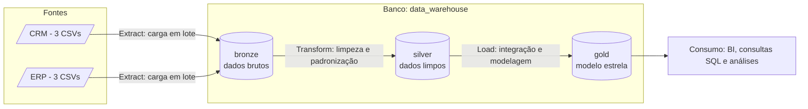

# Arquitetura de dados — Medalhão (Bronze → Silver → Gold)

## O que cada camada guarda

| Camada | Schema | Objetivo | Tipo de objeto | Transformação |
|---|---|---|---|---|
| Bronze | `bronze` | Guardar os dados exatamente como vieram da origem (rastreabilidade) | Tabelas | Nenhuma (carga bruta) |
| Silver | `silver` | Dados limpos e padronizados, ainda no formato das origens | Tabelas | Limpeza, padronização, tratamento de nulos e datas, remoção de duplicatas |
| Gold | `gold` | Modelo analítico pronto para o negócio | Views | Integração entre CRM e ERP, regras de negócio, modelo estrela (dimensões + fato) |

## Estratégia de carga
- **Bronze:** carga completa (*full load*) — `TRUNCATE` + `COPY` a partir dos CSVs.
- **Silver:** carga completa a partir da Bronze, via procedure.
- **Gold:** sem carga; as views leem direto da Silver.

## Fontes de dados
| Sistema | Arquivo | Conteúdo |
|---|---|---|
| CRM | `cust_info.csv` | Cadastro de clientes |
| CRM | `prd_info.csv` | Cadastro de produtos |
| CRM | `sales_details.csv` | Itens de vendas (transações) |
| ERP | `CUST_AZ12.csv` | Data de nascimento e gênero dos clientes |
| ERP | `LOC_A101.csv` | País dos clientes |
| ERP | `PX_CAT_G1V2.csv` | Categorias e subcategorias de produtos |
