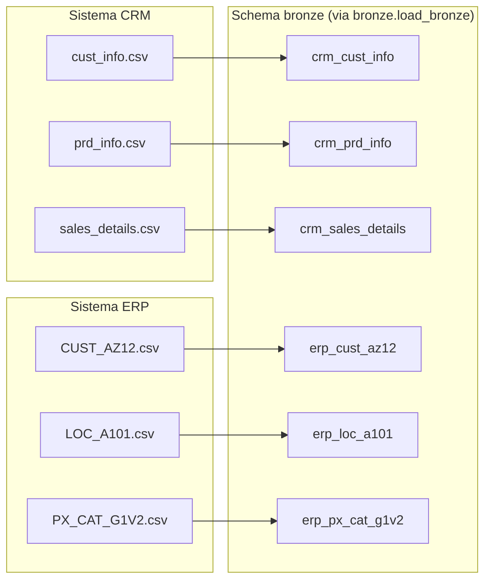
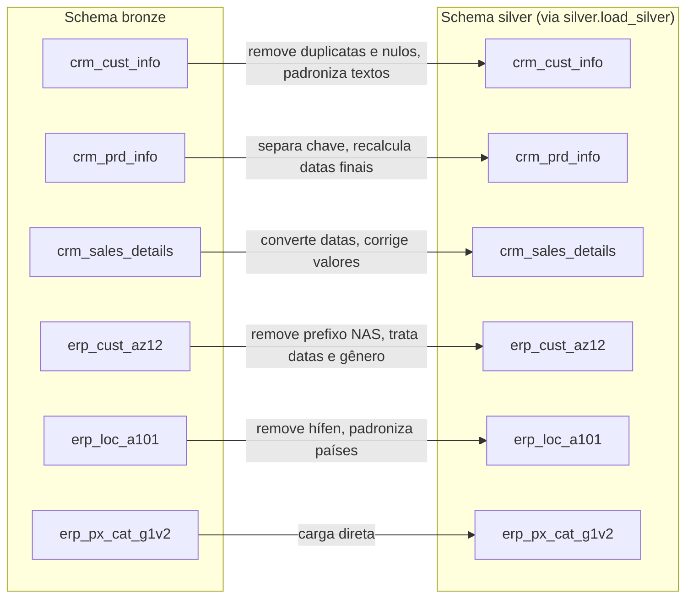

# Fluxo de dados (data flow)

Atualizado a cada camada concluída.

## Bronze — origem → tabelas brutas

Cada CSV vira exatamente uma tabela, sem transformação (relação 1:1).

## Silver — Bronze → tabelas limpas

Regras detalhadas, com as evidências: [`silver_cleaning_rules.md`](silver_cleaning_rules.md).

## Gold
_A documentar quando a camada for construída._
