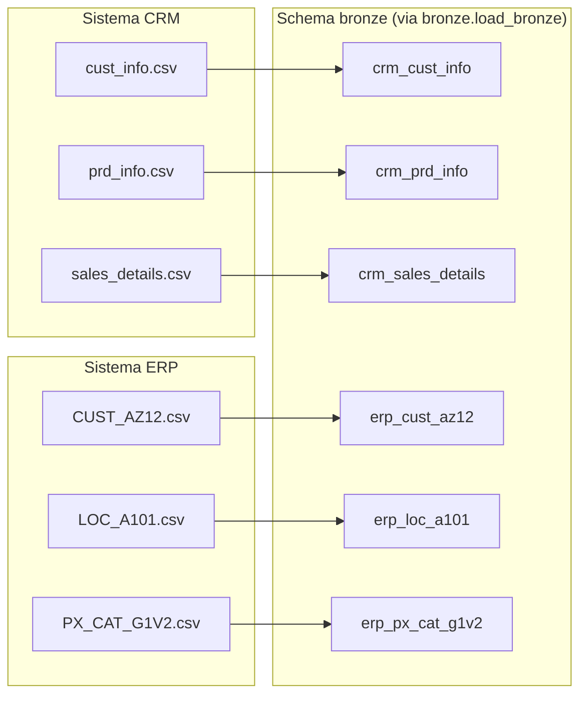

# Fluxo de dados (data flow)

Atualizado a cada camada concluída.

## Bronze — origem → tabelas brutas

Cada CSV vira exatamente uma tabela, sem transformação (relação 1:1).

## Silver
_A documentar quando a camada for construída._

## Gold
_A documentar quando a camada for construída._
