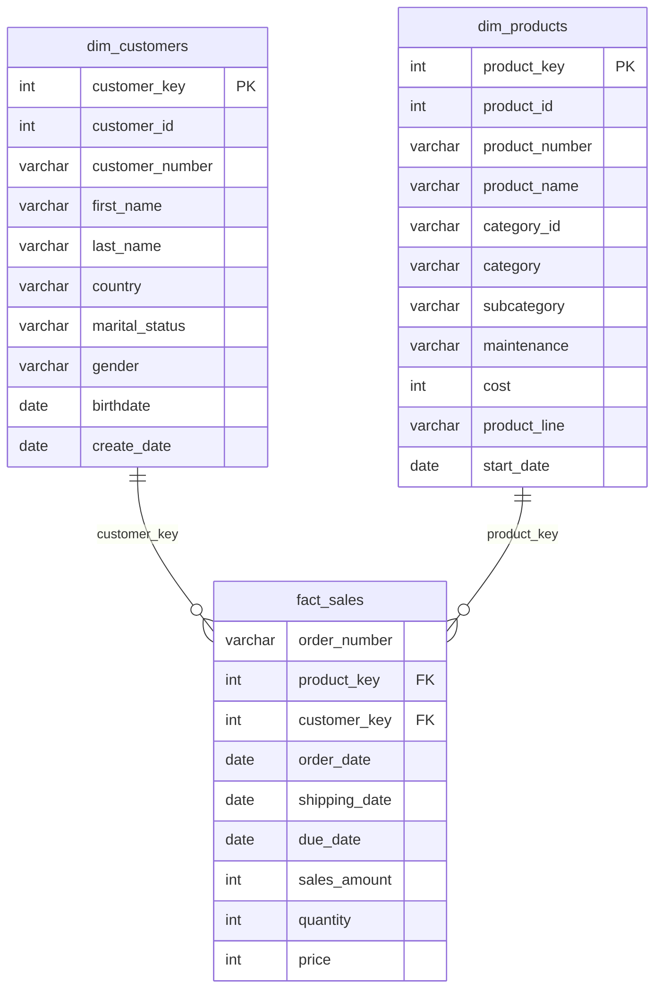

# Modelo de dados da Gold (esquema estrela)

- **Granularidade do fato:** uma linha por item vendido (um pedido com 3 produtos gera 3 linhas).
- **Por que estrela:** poucas junções (o fato liga direto a cada dimensão), consultas simples e rápidas
  para análise, e dimensões fáceis de entender pelo negócio. Uma tabela única gigante repetiria os dados do
  cliente e do produto em cada venda.
- **Chaves substitutas:** `customer_key` e `product_key` são geradas com `ROW_NUMBER()` dentro da view; servem para
  desacoplar o modelo dos códigos dos sistemas de origem, mas só são estáveis enquanto a Silver não muda.
